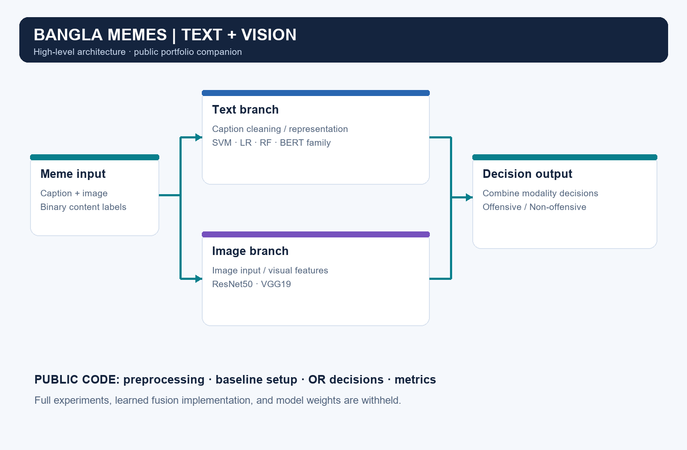

<div align="center">

# Sentiment Analysis for Bangla Memes
### A multimodal undergraduate thesis combining language and vision

**Yasin Chowdhury Amit · B.Sc. in Computer Science & Engineering · East Delta University**


[Project overview](docs/project_overview.md) · [Methodology](docs/methodology.md) · [Architecture](docs/model_architecture.md) · [Results](docs/results.md) · [Data](sample_data/README.md) · [Thesis screenshot](assets/screenshots/README.md)

</div>

## The problem

A meme's meaning comes from both its words and its image. This thesis investigates how to combine those signals to identify **offensive and non-offensive Bangla memes**, a content moderation task in a language with fewer research resources.

## My contribution

- Collected and organized a research corpus reported in the thesis as **6,835 memes with captions** and coordinated a four-annotator labeling process.
- Compared **SVM, Logistic Regression, Random Forest, and a BERT-based text model** with **ResNet50 and VGG19** image models.
- Investigated decision fusion to combine text and image predictions and compared class-level precision, recall, F1, accuracy, confusion matrices, and ROC curves.
- Documented the data pipeline, model comparisons, and findings in a complete undergraduate thesis supervised by **Mohammed Morshed Rana**.

**Skills demonstrated:** Python · Bangla text processing · scikit-learn · PyTorch / Transformers · TensorFlow / Keras · computer vision · evaluation · research documentation.

## Research at a glance

| Item | Thesis / public release |
|---|---|
| Task | Binary offensive content classification |
| Research corpus | 6,835 memes, as reported in the thesis |
| Highest reported fusion accuracy | **82%**, Table 4.8 |
| Highest reported OR fusion accuracy | **67%**, BanglishBERT + VGG19, Table 4.7 |
| Original files released here | **276 images and an Excel workbook containing 259 annotation rows** |
| Runnable walkthrough | Synthetic examples; no model download required |

These are **thesis-reported results**, not a fresh benchmark run. Evaluation populations differ across experiments; read the [result provenance and interpretation](docs/results.md) before comparing scores. The released files are a partial collection, not the full 6,835-record corpus.

## System overview



The public implementation covers small, readable examples of preprocessing, baseline configuration, OR fusion, and evaluation. Full experiment notebooks, learned fusion implementation, training orchestration, and model weights are withheld while the research remains unpublished.

## Selected results


The chart reproduces selected thesis figures. It is a portfolio summary; it does not establish a state-of-the-art claim or an independently verified generalization score.

## Try the public walkthrough

Use Python 3.10 or newer. From the repository root:

```bash
python -m venv .venv
# Windows PowerShell
.venv\Scripts\Activate.ps1
# macOS / Linux: source .venv/bin/activate
python -m pip install -r requirements.txt
python -m src.demo
```

The demo reads invented captions and predictions from `sample_data/synthetic_samples.json`, checks a synthetic image, combines example decisions, and prints an evaluation summary. **Its outputs are illustrative and are not thesis metrics.**

For notebooks:

```bash
python -m pip install notebook
jupyter notebook notebooks
```

| Notebook | What it demonstrates |
|---|---|
| [01 · Data preprocessing](notebooks/01_data_preprocessing.ipynb) | Configurable paths, schema checks, text cleaning |
| [02 · Text analysis](notebooks/02_text_analysis.ipynb) | Bangla-aware token inspection and baseline setup |
| [03 · Image analysis](notebooks/03_image_analysis.ipynb) | RGB conversion, resizing, and model overview |
| [04 · Model evaluation](notebooks/04_model_evaluation.ipynb) | OR fusion and metrics on synthetic predictions |

For your own locally held data, set `MEME_DATASET_PATH` and `MEME_IMAGE_ROOT` as explained in [.env.example](.env.example). Environment variables are read from the process; a `.env` file is not loaded automatically. Original released files are documented separately and are never rewritten by the demo.

## Repository map

```text
├── docs/             Project overview, methodology, architecture, results
├── notebooks/        Four focused public walkthroughs
├── src/
│   ├── preprocessing/  Configurable readers and caption cleaning
│   ├── text_models/    Baseline configuration and token inspection
│   ├── image_models/   Image input preparation
│   ├── fusion/         OR decision fusion only
│   └── evaluation/     Binary evaluation utilities
├── results/          Reported performance chart, confusion matrix, CSV
├── assets/           Architecture, workflow, distribution charts, screenshots
├── sample_data/
│   ├── original/     Owner-approved original workbook and 276 meme images
│   └── ...           Synthetic examples and dataset documentation
├── requirements.txt
├── .gitignore
└── LICENSE
```

## Data and publication scope

The original workbook and all 276 local meme images are included with the repository owner's explicit approval. They remain unchanged, including their filenames, text encoding, and annotation paths. See [dataset documentation](sample_data/README.md) for coverage and reading guidance. The demo uses synthetic data by default.

Public materials explain the high-level method. Withholding the full dataset or implementation does not prevent someone from studying or independently recreating a method using equivalent data.

## License and attribution

This repository already carried an **MIT license**, which is preserved in [LICENSE](LICENSE). No new license has been selected for the research dataset. Third-party meme images, logos, and embedded media retain their respective owners' rights; their inclusion does not grant ownership or blanket relicensing rights. See [rights and release scope](docs/release_scope.md).

## Research reference

Yasin Chowdhury Amit. *Sentiment Analysis for Bangla Memes Using Multimodal Approach.* B.Sc. thesis, Department of Computer Science & Engineering, East Delta University, May 2025. Supervisor: Mohammed Morshed Rana.

The thesis PDF and original experiment notebooks are retained privately. Documentation identifies the relevant thesis sections, tables, and printed page numbers for the reported figures.
