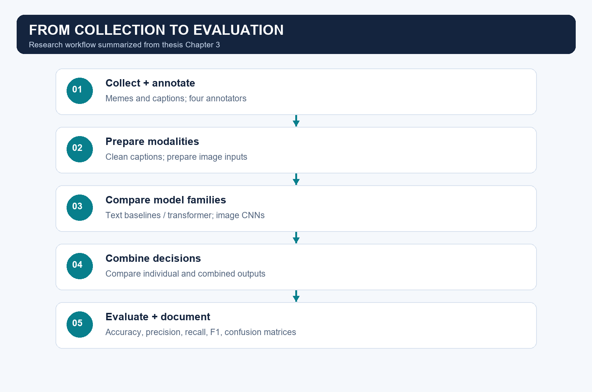

# Methodology

This document summarizes the thesis at a high level. It does not disclose the withheld learned fusion implementation or reproduce the full training workflow.

## 1. Collection and annotation

The thesis reports 6,835 memes collected manually from public social media sources (§3.1). Four annotators independently assigned offensive / non-offensive labels. Majority votes determined labels; an expert resolved ties (§3.2).

The distribution in thesis Table 3.1 is 3,590 offensive and 3,245 non-offensive memes. These are reported corpus statistics, not counts calculated from the smaller public workbook.

## 2. Text preparation

Captions were cleaned to remove unwanted characters and standardize whitespace. Traditional models used TF-IDF features. A BERT-based classifier used tokenization and attention masks. This public companion includes a small Bangla-aware cleaning and token-inspection example, with no full text-training experiment.

The thesis names the transformer BanglishBERT. The supplied notebooks currently select `sagorsarker/bangla-bert-base` when `USE_BANGLISH = False`. Public result labels retain the thesis terminology; they do not certify the checkpoint used in every historical run.

## 3. Image preparation

The thesis describes checking file availability, resizing images to 224 × 224, pixel normalization, and training augmentation. ResNet50 and VGG19 provide the visual model families. The public image module demonstrates RGB loading and resizing only; it is not a reproduction of model-specific training preprocessing.

## 4. Combining modalities

The study compares separate text and image predictions with combined decisions. The public OR example marks a meme offensive if either input decision is offensive. Other learned fusion research is summarized through approved aggregate results only; its implementation and training procedure are excluded.

## 5. Evaluation

The thesis uses accuracy, precision, recall, F1, confusion matrices, and ROC analysis. The public evaluation module computes binary metrics from explicit labels and predictions, and the notebooks use invented examples.

Published charts transcribe selected thesis figures. The original experiments have not been rerun or corrected for this release. See [results](results.md) for evaluation scope and provenance.

Sources: thesis §§3.1–3.7, printed pp. 12–28; Tables 3.1 and 4.7–4.8.
