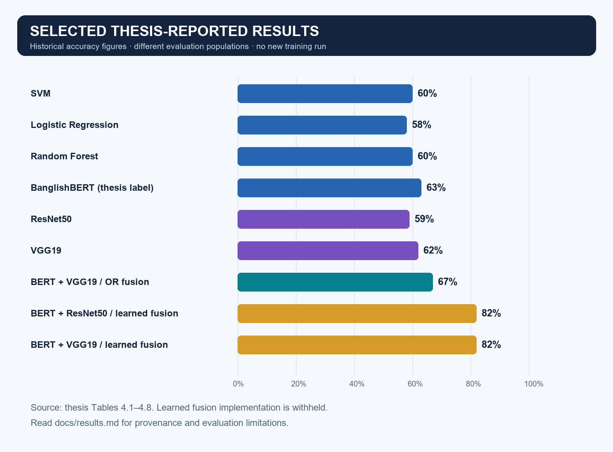
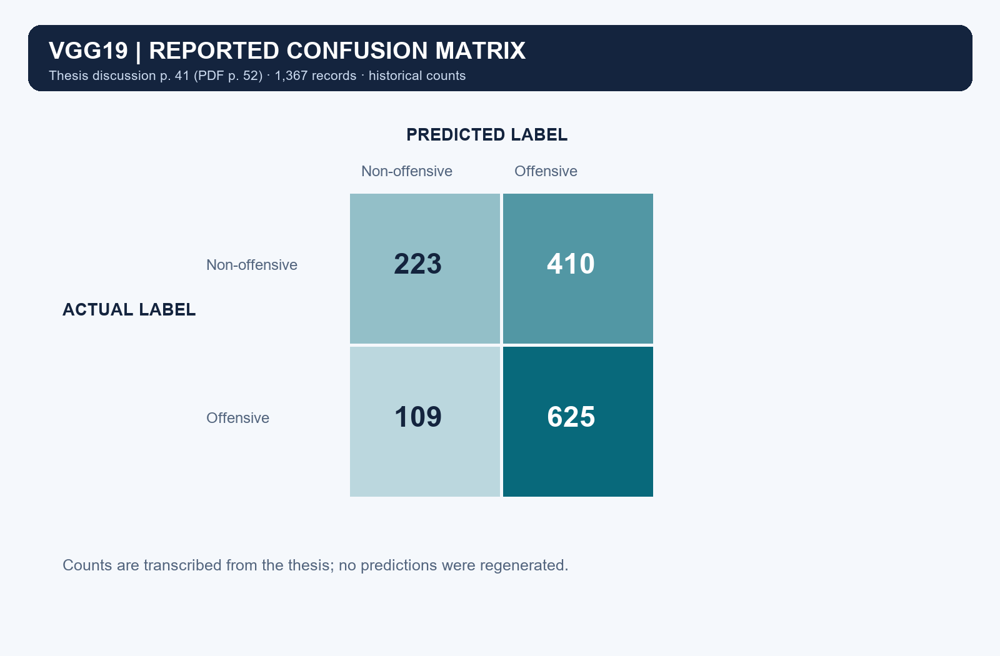
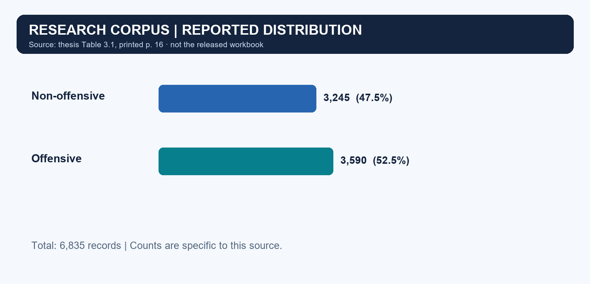
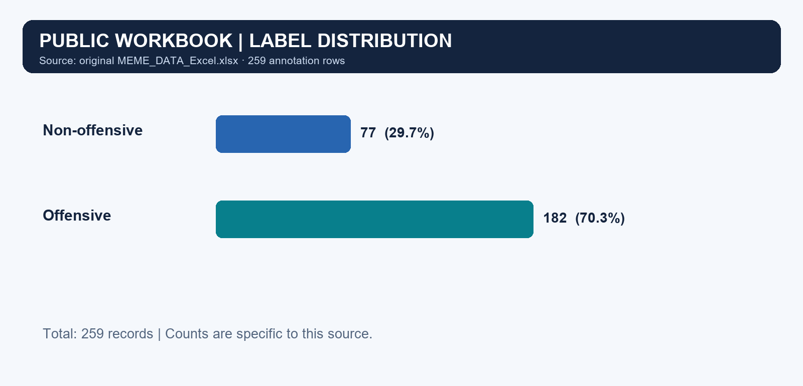

# Selected thesis results

**These figures are transcribed from the thesis, not regenerated from newly trained models.** Source: *Sentiment Analysis for Bangla Memes Using Multimodal Approach*, May 2025, Chapter 4. Table references use the thesis's printed page numbers; PDF page positions include 11 preliminary pages.

| Model / combination | Reported accuracy | Source |
|---|---:|---|
| SVM | 60% | Table 4.1, p. 30 |
| Logistic Regression | 58% | Table 4.2, p. 32 |
| Random Forest | 60% | Table 4.3, p. 34 |
| BanglishBERT (thesis label) | 63% | Table 4.4, p. 36 |
| ResNet50 | 59% | Table 4.5, p. 38 |
| VGG19 | 62% | Table 4.6, p. 40 |
| BanglishBERT + VGG19, OR fusion | 67% | Table 4.7, p. 42 |
| BanglishBERT + ResNet50, learned fusion | 82% | Table 4.8, p. 43 |
| BanglishBERT + VGG19, learned fusion | 82% | Table 4.8, p. 43 |

The [CSV](../results/model_comparison.csv) preserves selected reported values and identifies their source tables. Learned fusion results are shared as aggregates; implementation remains withheld.

## Selected confusion matrix

Counts are taken from the thesis's VGG19 confusion-matrix discussion, printed p. 41 (PDF p. 52): 223 correctly classified non-offensive, 410 non-offensive classified as offensive, 109 offensive classified as non-offensive, and 625 correctly classified offensive. Rows are actual labels; columns are predicted labels. The total is 1,367 records. These are historical counts, not predictions from the public sample.

## Reading the results

- Single-model reports commonly use 1,367 records. Saved OR fusion reports use all 6,835 records, including training records. The populations are not directly comparable as independent test sets.
- The learned fusion split is applied after base-model predictions are generated, and overlaps the image model's training population. The reported 82% therefore requires independent evaluation before it can be interpreted as unseen-data performance.
- Thesis Table 3.1 reports 3,245 non-offensive / 3,590 offensive records; saved full-dataset notebook reports use 3,123 / 3,712. The selected public materials retain their source figures rather than reconciling or altering the original research.
- Some thesis tables, prose, and saved notebook outputs differ. This summary consistently uses the stated source tables for the accuracy chart and the stated confusion-matrix passage for its counts.
- The supplied notebooks' current transformer selection differs from the thesis's BanglishBERT name. Historical labels are preserved, with the distinction documented in [methodology](methodology.md).

This release does not claim state-of-the-art performance or a fresh validated benchmark. No original experiment has been corrected or retrained.

## Dataset distributions

Thesis Table 3.1, p. 16: 3,590 offensive and 3,245 non-offensive, totaling 6,835.

The released workbook has 182 offensive and 77 non-offensive records, totaling 259. Its counts are separate from the full research corpus. See [dataset documentation](../sample_data/README.md).
